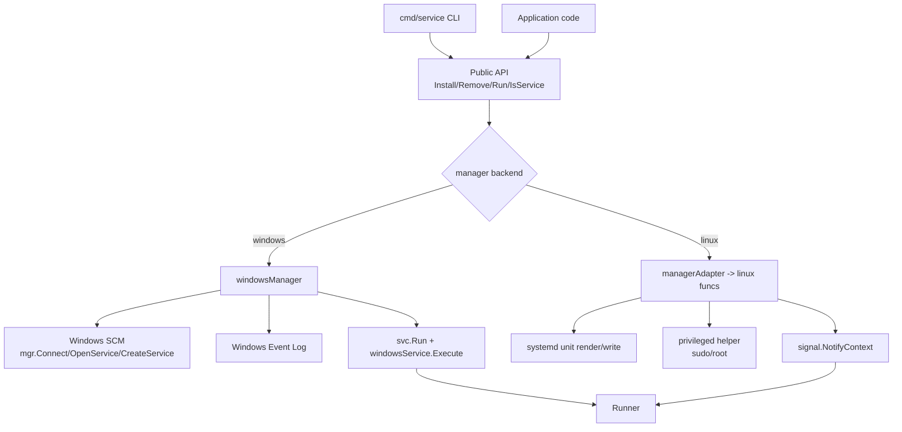
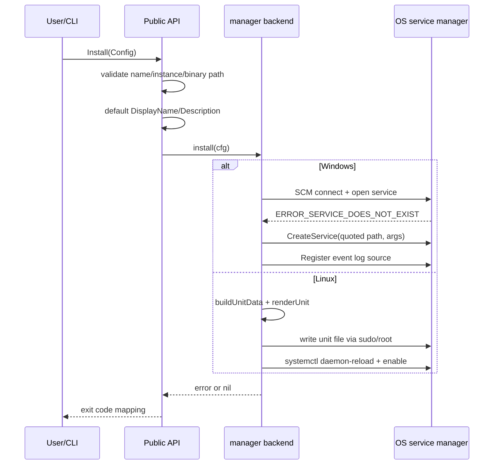
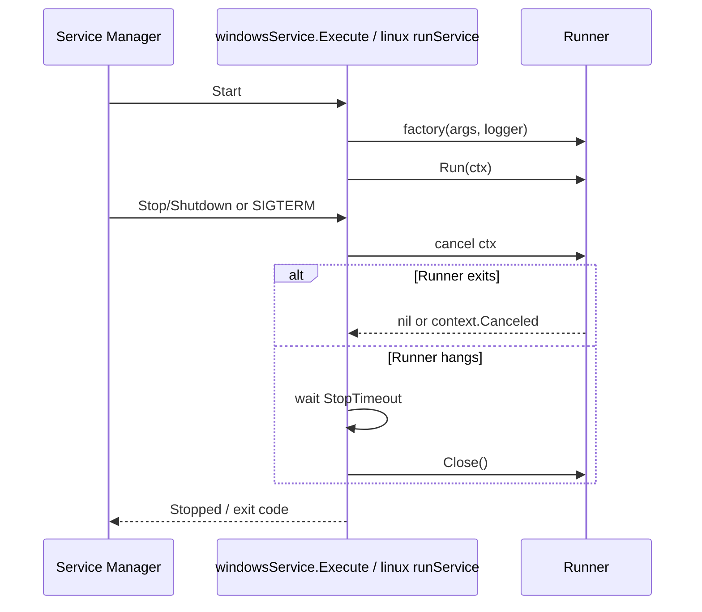
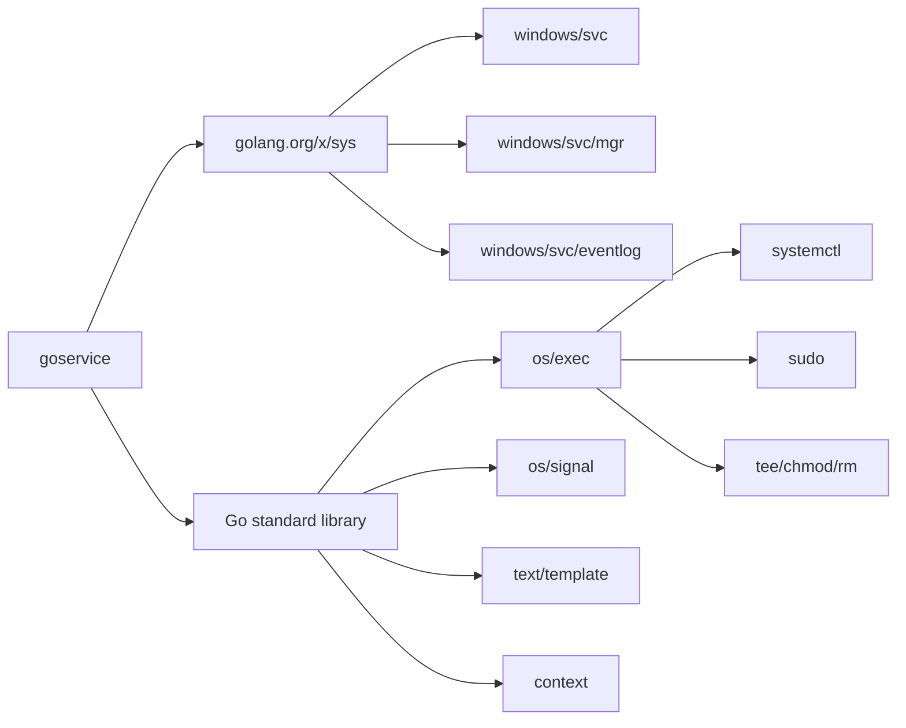
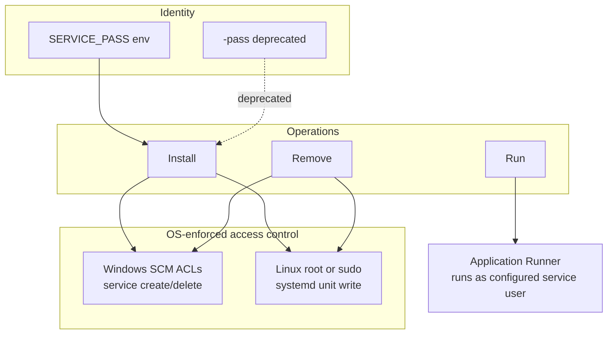

# Architecture

## Architecture and Design Choices

`goservice` is a small cross-platform library plus CLI for installing, removing, and running services on Windows (SCM) and Linux (systemd). The public API in `main.go` and `manager.go` is platform-neutral; platform behavior is isolated behind a `manager` backend selected at init time.

### Design choices

- **Single public API, pluggable backend.** `Install`, `Remove`, `Run`, and `IsService` delegate to a `manager` interface so tests and future platforms can replace OS integration.
- **Platform files are build-tagged.** `windows.go`, `linux.go`, `privileged.go`, and logger implementations are compiled only for their target OS.
- **Validation happens before OS calls.** Name, instance, binary path, and template inputs are checked before touching SCM or systemd.
- **Secrets are handled at the CLI boundary.** `SERVICE_PASS` is preferred; `-pass` is deprecated and scrubbed after use.
- **Shutdown is explicit and bounded.** Both platforms use cancellation plus a configurable timeout (`StopTimeout`, `StopPollInterval`).

### Assumptions

- Windows install/remove requires SCM access; service run requires the binary be started by the SCM or `-run`.
- Linux install/remove requires root or passwordless sudo.
- systemd is the Linux init system.
- The managed binary path is absolute and trusted.
- No network communication is performed by the library or CLI.

### Edge cases

- Service already exists / not installed.
- Binary path contains spaces (Windows) or systemd-special characters (Linux).
- Custom systemd template is missing, a symlink, or not a regular file.
- Runner ignores cancellation; shutdown timeout forces `Close`.
- Windows service user without a password is rejected before SCM calls.
- Linux instance names are validated and length-limited.

### Performance and efficiency

- Root/sudo checks are cached per process.
- Windows stop polling uses a configurable interval and timeout.
- Linux shutdown waits for runner completion or context cancellation with a bounded timeout.
- No background goroutines are left running after `Run` returns.

---

## Data Flow and Control Logic

### Operational flow

1. CLI parses flags into `goservice.Config`.
2. CLI normalizes platform-specific fields (`-user` on Linux becomes `UserGroup`).
3. CLI validates mode selection and Windows password requirements.
4. Public API validates `Config` and applies defaults.
5. Platform backend performs install/remove/run.
6. Runner executes until completion, signal, or shutdown timeout.

### Code relations

- `main.go`: interfaces, `Config`, validation, sentinel errors, timeout helpers.
- `manager.go`: public API dispatch and `manager` abstraction.
- `windows.go`: SCM/eventlog/service runtime integration.
- `linux.go`: systemd unit rendering and lifecycle.
- `privileged.go`: root/sudo command execution and file writes.
- `cmd/service/main.go`: CLI parsing, exit-code mapping, subprocess runner.

### Install sequence

### Run/shutdown sequence

---

## Performance and Scalability

### Concurrency model

- The library is not a server; concurrency is limited to service shutdown handling.
- Windows uses one goroutine for `Runner.Run(ctx)` and the SCM control loop in `Execute`.
- Linux uses one goroutine for `Runner.Run(ctx)` and a `select` on runner completion vs signal cancellation.
- No shared mutable state is accessed concurrently except the runner's own context cancellation.

### Channel structures

- `errChan` / `runErr` are buffered (`cap=1`) so the runner goroutine cannot leak after shutdown.
- Windows SCM control uses the `svc.ChangeRequest` and `svc.Status` channels provided by `x/sys/windows/svc`.
- Linux shutdown uses `signal.NotifyContext` instead of manual signal channel handling.

### Scalability notes

- The package manages one service process per invocation; it does not orchestrate multiple services.
- Install/remove are short-lived operations dominated by OS calls.
- Runtime cost is determined by the application's `Runner`, not by the service wrapper.

---

## Dependencies

### Runtime modules

- `github.com/edsilegxrepo/goservice` (this module)
- `golang.org/x/sys v0.47.0`

### Standard library usage

- `context`, `errors`, `flag`, `fmt`, `log`, `os`, `os/exec`, `os/signal`, `os/user`, `path/filepath`, `regexp`, `runtime`, `strings`, `sync`, `syscall`, `text/template`, `time`

### External utilities used at runtime

- Windows: Service Control Manager, Windows Event Log
- Linux: `systemctl`, `sudo` (when not root), `tee`, `chmod`, `rm`

---

## Security Architecture

`goservice` does not implement its own authentication or RBAC. It relies on the host OS security boundary: Windows SCM permissions and Linux root/sudo/systemd policy.

### Authentication layers

- **Windows service account:** `Config.User` + `Config.Pass` are passed to SCM only when a custom service user is configured.
- **Linux privilege escalation:** root is used directly; otherwise `sudo -n` is required.
- **CLI secret source:** `SERVICE_PASS` is preferred over command-line input.

### Supported methods

- Windows SCM service logon credentials.
- Linux systemd `User=`/`Group=` unit directives.
- OS-level permission checks for service creation/deletion.

### RBAC model

- No application-level RBAC exists.
- Authorization is delegated to the operating system:
  - Windows: SCM security descriptors and service account rights.
  - Linux: root, sudoers policy, and systemd unit ownership.
