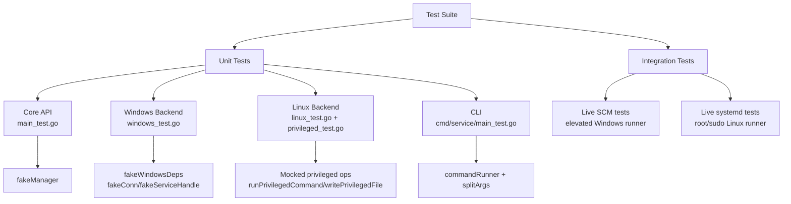
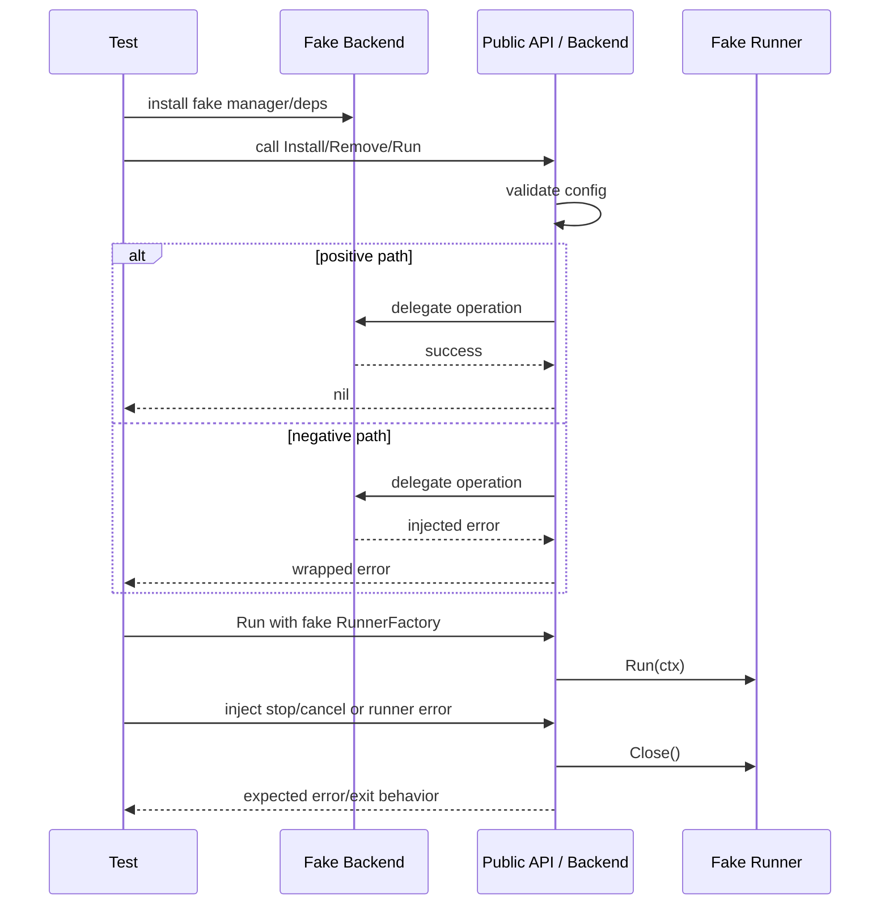

# Testing

This document describes the test architecture, execution model, coverage requirements, and maintenance rules for `goservice`.

> **Maintenance rule:** when code is modified and compiles, update this file with any new tests and refreshed coverage statistics.

## Architecture, Design and Principles of the Test Suite

The suite is built around **dependency injection and fake platform backends**. Tests never require administrator rights, a real Windows SCM, a real systemd instance, or sudo.



### Principles

- **No host mutation in unit tests.** All SCM/systemd/sudo interactions are replaced with fakes.
- **Positive and negative paths are both covered.** Each operation tests success, validation failure, backend failure, and timeout/cancellation behavior.
- **Cross-platform parity.** Windows and Linux backends are tested independently using the same public API contracts.
- **Deterministic shutdown.** Runner cancellation, `Close()`, and timeout behavior are explicit test targets.
- **Secrets are never required by tests.** Windows password logic is validated through configuration, not real credentials.

## Logic Flow of the Tests



### Main categories

- **Validation:** service name, instance, binary path, template constraints.
- **Public API:** `Install`, `Remove`, `Run`, `IsService` through `defaultManager` fakes.
- **Windows backend:** SCM connect/open/create/delete, event log registration, service runtime `Execute`.
- **Linux backend:** systemd escaping, unit rendering, install/remove, privileged command/file operations, shutdown.
- **CLI:** argument splitting, runner factory, subprocess runner lifecycle.
- **Negative testing:** invalid input, backend errors, missing services, permission failures, timeout/cancellation.

## Technical Requirements and Setup

### Dependencies

- Go toolchain matching `go.mod` (`go 1.26`).
- `golang.org/x/sys v0.47.0`.
- Windows tests run on Windows.
- Linux tests run on Linux or through WSL using a Linux test binary built on Windows.

### Environment variables

- `GOOS=linux` when building the Linux test binary on Windows.
- `SERVICE_PASS` is **not** required for tests; secret handling is tested through config state only.
- `TEMP` / `TMP` are used for the Linux test binary when running through WSL.

### Constraints

- Unit tests must not write to `/etc`, the Windows SCM, or the Windows Event Log.
- Unit tests must not require root, sudo, or elevated SCM rights.
- Live integration tests require separate elevated runners and are not part of the default unit-test command.
- Temporary binaries and coverage files must be removed after use.

## List of Tests

| Logical Group | Test Name | Technical Purpose / Description | Success Criteria (PASS) |
| --- | --- | --- | --- |
| Core validation | `TestValidateName` | Accept valid names and reject empty/invalid/too-long names. | Valid names return nil; invalid names return `ErrInvalidConfig`. |
| Core validation | `TestValidateInstance` | Accept empty/valid instance and reject invalid characters. | Valid returns nil; invalid returns error. |
| Core validation | `TestValidateBinaryPath` | Accept absolute file; reject relative path, missing file, directory, invalid chars. | Only an existing absolute non-directory file passes. |
| Core API | `TestInstallValidation` | `Install` rejects empty config before backend call. | Returns `ErrInvalidConfig`. |
| Core API | `TestInstallDefaults` | `Install` defaults `DisplayName` and `Description`. | Fake manager receives defaulted config. |
| Core API | `TestInstallDefaultsBinary` | `Install` defaults `BinaryPath` via `os.Executable`. | Fake manager receives non-empty binary path. |
| Core API | `TestInstallPassesManagerError` | Backend install errors propagate. | Non-nil error returned. |
| Core API | `TestRemove` | `Remove` delegates to backend. | Fake manager records one remove call. |
| Core API | `TestRemoveValidation` | `Remove` rejects empty config. | Returns `ErrInvalidConfig`. |
| Core API | `TestRun` | `Run` creates logger and delegates to backend. | Fake manager records one run call. |
| Core API | `TestRunNilFactory` | `Run` rejects nil runner factory. | Returns `ErrInvalidConfig`. |
| Core API | `TestIsService` | `IsService` reflects backend result and hides detection errors. | True/False match fake; error returns false. |
| Windows quoting | `TestQuotePath` | Quote only paths containing whitespace. | Plain path unchanged; spaced path quoted. |
| Windows install | `TestWindowsInstallSuccess` | Create service and register event log source. | No error. |
| Windows install | `TestWindowsInstallAlreadyExists` | Existing service maps to `ErrAlreadyExists`. | Non-nil error. |
| Windows install | `TestWindowsInstallOpenOtherError` | SCM open errors propagate. | Non-nil error. |
| Windows install | `TestWindowsInstallCreateError` | SCM create errors propagate. | Non-nil error. |
| Windows install | `TestWindowsInstallEventLogError` | Event log failure deletes created service. | Non-nil error. |
| Windows remove | `TestWindowsRemoveSuccess` | Stop-confirm-delete-remove event log succeeds. | No error. |
| Windows remove | `TestWindowsRemoveNotInstalled` | Missing service maps to `ErrNotInstalled`. | Non-nil error. |
| Windows remove | `TestWindowsRemoveDeleteError` | Delete failure propagates. | Non-nil error. |
| Windows remove | `TestWindowsRemoveEventLogError` | Event log removal failure propagates. | Non-nil error. |
| Windows run | `TestWindowsManagerRunService` | `runService` delegates to deps with service name/handler. | Fake deps record run call. |
| Windows runtime | `TestWindowsExecuteStop` | SCM stop cancels runner and closes it. | Runner ran and closed; errno 0. |
| Windows runtime | `TestWindowsExecuteRunnerError` | Runner error maps to errno 2 and closes runner. | errno 2; runner closed. |
| Linux escaping | `TestSystemdEscape` | Newlines collapse and `%` is doubled. | Escaped output matches expected. |
| Linux escaping | `TestSystemdArg` | Quote args only when needed; escape quotes/`%`. | Each case matches expected. |
| Linux escaping | `TestQuoteSystemdArgs` | Build `ExecStart` with quoted args. | Combined string matches expected. |
| Linux unit data | `TestBuildUnitData` | Build user/group/home/exec fields; reject invalid user/group. | Fields match; invalid configs error. |
| Linux unit data | `TestBuildUnitDataEscapesDescription` | Description is escaped for systemd. | No raw newline; `%` doubled. |
| Linux render | `TestRenderUnitDefault` | Default template renders unit content. | Contains `ExecStart` and `Description`. |
| Linux render | `TestRenderUnitCustomTemplate` | Custom template is read, statted, and rendered. | Contains expected rendered content. |
| Linux render | `TestRenderUnitTemplateReadError` | Template read failure propagates. | Non-nil error. |
| Linux install | `TestInstallSimple` | Write unit, daemon-reload, enable. | One unit write; expected systemctl calls. |
| Linux install | `TestInstallTemplated` | Instance unit path/name are templated. | Writes `svc@.service`; enables `svc@inst`. |
| Linux install | `TestInstallWriteFails` | Unit write failure propagates. | Non-nil error. |
| Linux remove | `TestRemoveSimple` | Stop/disable/reload/remove unit. | One remove; expected systemctl calls. |
| Linux remove | `TestRemoveDisableFails` | Disable failure stops removal. | Non-nil error. |
| Linux run | `TestLinuxRunService` | Runner runs, cancellation is honored, `Close` is called. | Returns `context.Canceled`; runner ran/closed. |
| Privilege detection | `TestCheckRoot` | UID 0 detected as root. | `CheckRoot()` true. |
| Privilege detection | `TestCheckNotRoot` | Non-zero UID detected as non-root. | `CheckRoot()` false. |
| Privilege detection | `TestCanSudoWhenSudoAvailable` | sudo present and `sudo -n true` succeeds. | `CanSudo()` true. |
| Privilege detection | `TestCanSudoWhenSudoMissing` | sudo binary missing. | `CanSudo()` false. |
| Privilege commands | `TestWithSudoAsRoot` | Root executes command directly. | Args are `ls -l`. |
| Privilege commands | `TestWithSudoAsNonRoot` | Non-root uses sudo prefix. | Args are `sudo ls -l`. |
| Privilege files | `TestWritePrivilegedFileReturnsError` | tee/write failure propagates. | Non-nil error. |
| CLI parsing | `TestSplitArgs` | Split args with quotes/escapes. | Each case matches expected slice. |
| CLI runner | `TestMakeRunnerFactory` | Factory builds `commandRunner` with path/args/exec. | Runner fields match config. |
| CLI runner | `TestCommandRunnerRun` | Subprocess runs successfully and sets cancel. | `Run` returns nil; cancel set. |
| CLI runner | `TestCommandRunnerClose` | `Close` is safe on zero runner. | No error. |
| Core API | `TestIsServiceErr` | `IsServiceErr` returns backend result and detection error. | True/nil on success; error propagated. |
| Core API | `TestManagerAdapter` | Adapter forwards all four manager calls. | All four fake functions invoked. |
| Core API | `TestConsoleLogger` | Console logger methods do not fail. | Error/Info/Warn/Close complete. |
| Core API | `TestNewLogger` | `NewLogger` returns a logger in service and console modes. | Non-nil logger; `Close` succeeds. |
| Core validation | `TestValidateBinaryPathInvalidChars` | Binary paths containing quotes/control chars are rejected. | Returns `ErrInvalidConfig`. |
| Core API | `TestStopTimeoutDefaults` | Stop timeout and poll interval defaults are applied. | Defaults and custom values match. |
| Windows backend | `TestWindowsManagerIsServiceRealDeps` | Real Windows deps answer `isService` safely. | No panic; error tolerated. |
| Windows remove | `TestWindowsRemoveStopTimeout` | Removal fails when service does not stop before timeout. | Non-nil timeout error. |
| Windows remove | `TestWindowsRemoveControlErrorButStopped` | Removal succeeds if service is already stopped despite control error. | No error. |
| Windows runtime | `TestWindowsExecuteFactoryError` | Runner factory failure maps to errno 1. | errno 1. |
| Windows logging | `TestWindowsEventLogger` | Event log logger forwards Error/Info/Warn/Close. | Four fake event-log calls. |
| Windows logging | `TestNewLoggerEventLogFallback` | Missing event source falls back to console logger. | Returns `*consoleLogger`. |
| Windows backend | `TestRealWindowsDeps` | Real deps route isService/run/connect/eventlog through injectable vars. | Expected results from fakes. |
| Linux backend | `TestLinuxIsService` | Linux `isService` is always false. | Returns false, nil. |
| Linux unit data | `TestBuildUnitDataUserFallback` | `Config.User` is used when `UserGroup` is empty. | User/home resolved from lookup. |
| Linux render | `TestRenderUnitParseError` | Invalid custom template returns parse error. | Non-nil error. |
| Linux install | `TestInstallDaemonReloadFails` | daemon-reload failure propagates. | Non-nil error. |
| Linux install | `TestInstallEnableFails` | enable failure propagates. | Non-nil error. |
| Linux remove | `TestRemoveDaemonReloadFails` | daemon-reload failure propagates. | Non-nil error. |
| Linux remove | `TestRemoveFileFails` | Unit file removal failure propagates. | Non-nil error. |
| Linux run | `TestLinuxRunServiceRunnerError` | Runner error propagates and runner is closed. | Non-nil error; closed true. |
| Linux run | `TestLinuxRunServiceCloseError` | Runner close error propagates. | Non-nil error. |
| Privilege commands | `TestRunCommandError` | Failing command returns error. | Non-nil error. |
| Privilege commands | `TestRunPrivilegedCommandSudoError` | Missing sudo blocks privileged command. | Non-nil error. |
| Privilege commands | `TestRunPrivilegedCommandWithStdinSudoError` | Missing sudo blocks privileged stdin command. | Non-nil error. |
| Privilege files | `TestRemovePrivilegedFileError` | Privileged remove failure propagates. | Non-nil error. |
| Privilege files | `TestWritePrivilegedFileSymlink` | Symlink unit path is rejected before write. | Non-nil error. |
| CLI parsing | `TestParseConfig` | Flags are parsed into config and options. | Fields and args match. |
| CLI parsing | `TestParseConfigUserNormalization` | `-user` is preserved on Windows and normalized to `UserGroup` on Linux. | Platform-specific expectation holds. |
| CLI parsing | `TestParseConfigUnknownFlag` | Unknown flag returns usage error. | Returns `exitUsage`. |
| CLI validation | `TestValidateMode` | Mode selection and required fields are enforced. | Each case returns expected code. |
| CLI errors | `TestExitCodeForError` | Sentinel errors map to granular exit codes. | Each error maps to expected code. |
| CLI secrets | `TestScrubSecrets` | Password and env var are cleared. | Both empty after call. |
| CLI run | `TestRunInstallSuccess` | Successful install returns exitOK. | One fake install call. |
| CLI run | `TestRunInstallAlreadyExists` | Already-exists maps to exitAlreadyExists. | Correct exit code. |
| CLI run | `TestRunUsageError` | Usage error returns exitUsage without backend call. | Correct exit code; no installs. |
| CLI run | `TestRunRemoveNotInstalled` | Not-installed maps to exitNotInstalled. | Correct exit code. |
| CLI run | `TestRunAutoRunWhenService` | SCM auto-detection selects run mode. | One fake run call. |
| CLI run | `TestRunContextCanceled` | Graceful shutdown maps to exitOK. | Correct exit code. |
| CLI run | `TestRunRuntimeError` | Runtime error maps to exitRuntime. | Correct exit code. |
| CLI run | `TestRunScrubsSecrets` | Env password reaches install and is scrubbed after run. | Password passed; env unset after. |

## Code Coverage Report

**Coverage target:** 80% or higher per package. Current coverage meets the target on both platforms.

### Up-to-date statistics

| Package | Platform | Coverage |
| --- | --- | --- |
| `github.com/edsilegxrepo/goservice` | Windows | **81.3%** |
| `github.com/edsilegxrepo/goservice/cmd/service` | Windows | **90.2%** |
| `github.com/edsilegxrepo/goservice` | Linux (WSL test binary) | **86.6%** |

`go test` does not emit a single module-wide total across OS-specific files; use the per-package values above as the release gate.

### How to refresh the statistics

Windows:

```powershell
Remove-Item Env:GOOS -ErrorAction SilentlyContinue
go test -timeout 30s -cover .
go test -timeout 30s -cover ./cmd/service
```

Linux via WSL:

```powershell
$dir = Join-Path $env:TEMP 'goservice-linux-test'
New-Item -ItemType Directory -Force $dir | Out-Null
$win = Join-Path $dir 'service-cover.test'
$env:GOOS = 'linux'
go test -c -cover -covermode=set -o $win .
Remove-Item Env:GOOS -ErrorAction SilentlyContinue
$drive = $win.Substring(0,1).ToLower()
$rest = $win.Substring(2).Replace([char]92,'/')
$wsl = "/mnt/$drive$rest"
wsl bash -lc "chmod +x '$wsl' && '$wsl' -test.coverprofile='/tmp/linuxcover.out'"
```

For function-level details on Windows:

```powershell
go test -timeout 30s -coverprofile=covprofile .
go tool cover -func=covprofile
```

## Realistic Data Simulation

Unit tests simulate realistic inputs without touching the host: spaced Windows paths, systemd-special characters, templated instances, SCM errors, sudo availability, cancellation, and runner hangs.

### Mandatory integration tests for release

Live integration tests are required before production release and must cover 100% of externally visible functionality:

- **Windows elevated runner:** install/run/stop/remove a real service against the local SCM.
- **Linux root runner:** install/enable/start/stop/disable/remove a real systemd unit on a disposable VM or container.
- **Listener-based validation:** the demo service must open a local TCP listener and prove the service manager reports it as running before shutdown.

These tests require elevated CI runners and must not run as part of the default unit-test command.

## How to Run the Tests

### PowerShell (Windows host)

```powershell
# Unit tests
go test -timeout 30s ./...

# With coverage summary
go test -timeout 30s -cover .
go test -timeout 30s -cover ./cmd/service

# Function-level coverage
go test -timeout 30s -coverprofile=covprofile .
go tool cover -func=covprofile
```

### Bash (Linux or WSL)

```bash
# Native Linux
go test -timeout 30s ./...

# Linux test binary built on Windows and executed in WSL
chmod +x /mnt/f/TEMP/goservice-linux-test/service.test
/mnt/f/TEMP/goservice-linux-test/service.test
```

## Maintenance and Troubleshooting

- **Update this document after code changes.** Add new tests to the table and refresh coverage numbers.
- **If WSL cannot find the test binary**, verify the Windows temp path and convert it to `/mnt/<drive>/...` form.
- **If Linux coverage says the binary was not built with coverage**, rebuild with `go test -c -cover -covermode=set`.
- **If Windows tests hang**, check fake service handle status values; stop loops terminate only when the state becomes `svc.Stopped`.
- **If CLI tests fail on Linux**, ensure the `go` binary is available for `TestCommandRunnerRun` or replace it with a platform-neutral command.
- **Clean artifacts** after coverage or WSL runs: remove `covprofile`, `coverage.out`, `service.test`, and temp directories.
